# Breakout Predictor

A Windows desktop app that scans the **Nifty 500** with live **Upstox** data and flags stocks that are
*likely* to break out above their 20-day high within the next **7 trading sessions**, before it happens.
It emails you only when new setups appear.

Pure Python standard library (Tkinter + urllib). Nothing to `pip install`.

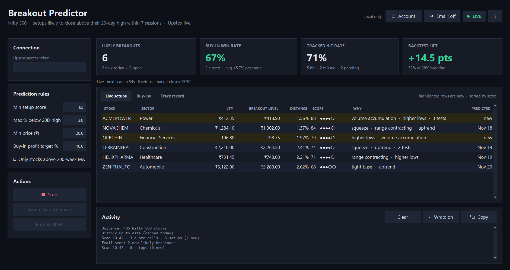

## How to use

Click **?** in the top-right corner of the app (or press **F1**) to open this guide inside the app. The screenshots
use made-up demo stocks.

### 1. Paste your Upstox token

Upstox developer console → **My Apps → Analytics token** (read-only, valid for a year). Paste it under
**Connection**. It stays in memory only and is never saved or uploaded.

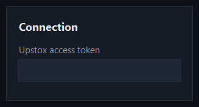

### 2. Set your rules

- **Min setup score**: how strict predictions are (65 is a good start).
- **Max % below 20D high**: how close to the breakout level a stock must be.
- **Min price**: skips penny stocks.
- **Buy-in profit target %**: target for buy-ins (10% by default).
- **Only stocks above 200-week MA**: keep only long-term uptrends.

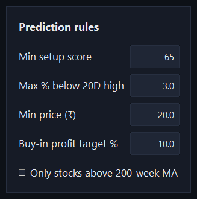

### 3. Run it

- **Start live predictor**: scans every minute while the market is open (09:15–15:30 IST, Mon–Fri) and emails new
  setups and buy-in signals.
- **Scan now**: a single scan without emails, for a quick look.
- **Run backtest**: replays the rules over the past year so you can see whether they work.

The first run of the day downloads about a year of candles, which takes a few minutes.

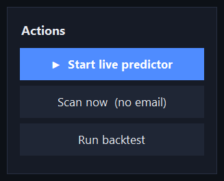

### 4. Read the scoreboard

- **LIKELY BREAKOUTS**: setups right now.
- **BUY-IN WIN RATE**: share of closed buy-ins that hit the target.
- **TRACKED HIT RATE**: share of past predictions that broke out within 7 sessions.
- **BACKTEST LIFT**: how many percentage points more often the picks broke out than every stock near its 20-day
  high. Positive means the score helps.

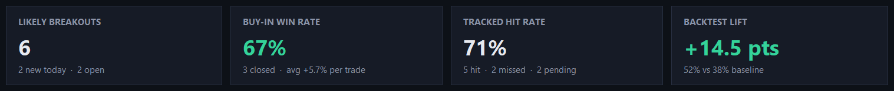

### 5. Live setups

Each row is a predicted breakout:

- **BREAKOUT LEVEL**: the 20-day high to beat.
- **DISTANCE**: how far below it the price is.
- **SCORE**: 0–100.
- **WHY**: what pushed the score up.

Highlighted rows are new in this scan. When the market is closed, the tab previews the next session.
Click any column heading to sort by it, and click again to reverse. This works in all three tables.

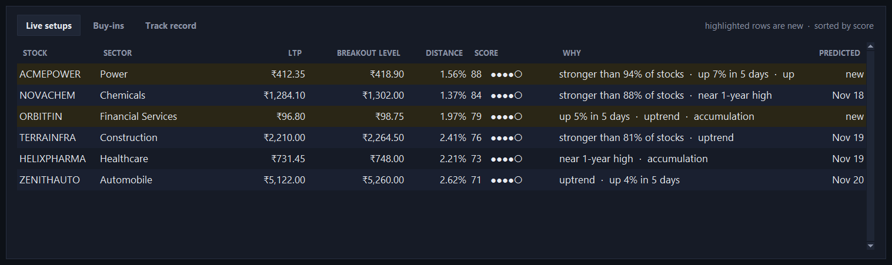

### 6. Buy-ins

Predicted stocks that break out move here and are followed through each stage: **Waiting for retest → Buy above ₹X →
In trade → Target hit / Stopped out / Expired**. **APP BUY-IN**, **STOP** and **TARGET** are the app's plan. The
filters show active trades, winners, losers or stocks that never gave an entry.

**P&L in % / ₹** switches the P&L columns between percent and rupees. Rupees assume you put the **per trade**
amount (₹1,00,000 by default) into whole shares at each buy price. The summary above the table then shows the
app's booked and open profit in rupees. A • marks a position that's still open. Rows with a P&L turn green when it's up and red
when it's down; in Track record the same goes for the MOVE.

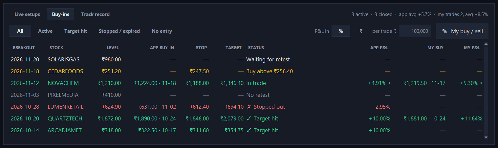

### 7. Record your own trade

Select a row and click **✎ My buy / sell** (or double-click it). Enter the price, date and time you bought at, and
optionally where you sold. **MY P&L** then sits next to **APP P&L**. A **•** marks a position that's still open,
valued at the live price (or the last close).

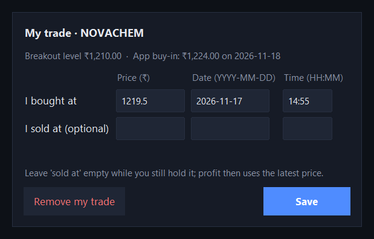

### 8. Track record

Every live prediction is graded automatically. A **hit** is a daily close above the breakout level within 7 sessions;
anything else is a **miss**. Filter by hits, misses or open.

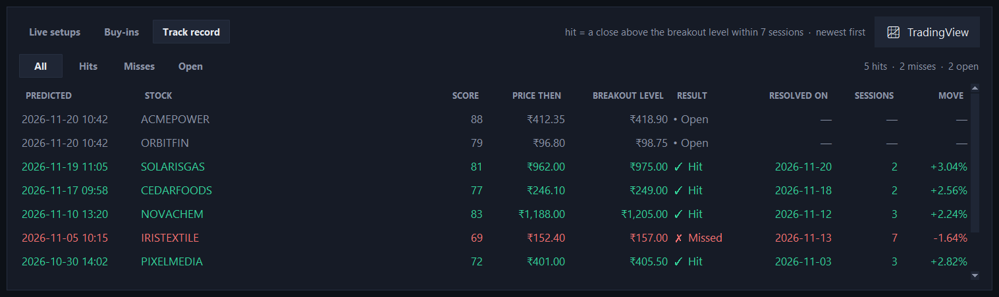

### 9. Email alerts, account and help

- **Email** opens the SMTP settings.
- **Account** signs you in so your data follows you to any PC.
- The pill shows whether the predictor is running.
- **?** opens the guide.

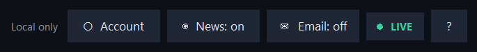

### 10. Activity log

The log shows what the app is doing: downloads, scans, alerts and errors.

- **Copy** puts the whole log on the clipboard, handy for reporting a problem.
- **Wrap** toggles line wrapping.

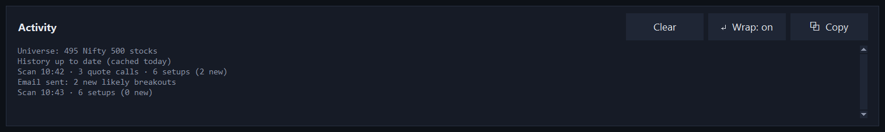

To regenerate these screenshots after a UI change, run `py tools/make_screenshots.py` (Windows). It uses demo data in
a temporary folder and captures only the app's own window.

## How it works

1. **Once a day** it downloads about a year of daily candles for every Nifty 500 stock from Upstox (throttled,
   cached locally).
2. **Every minute during market hours** (09:15–15:30 IST, Mon–Fri) it makes 3 batched Upstox quote calls and
   scores each stock that sits 0–3% below its 20-day high.
3. Stocks scoring at or above your threshold are shown in the table and, if email is set up, sent in one email.
   Each stock is alerted once while its prediction is open.
4. Every prediction is logged and graded automatically: a **hit** is a daily close above the breakout level
   within 7 sessions. The **Track record** tab lists every prediction with its result, the date it resolved, how
   many sessions it took and the price move, filterable by hits, misses and open.

### Buy-ins: breakout, retest, bounce

Every predicted stock that breaks out (closes above its 20-day high) moves to the **Buy-ins** tab and is followed
through:

1. **Waiting for retest** – up to 10 sessions for the price to come back to the old ceiling: a day whose low is within
   1.5% above it and whose close stays no more than 1% below it. A close 3%+ below the ceiling = *failed breakout*.
2. **Retesting** – the buy trigger is the retest day's high. Each new retest touch resets it. No move above it within
   5 sessions = *no bounce*.
3. **In trade** – entry when price goes above the retest day's high (at the open if it gaps above). Stop 1% below the
   retest day's low; target **+10%** (setting *Buy-in profit target %*).
4. **Result** – *target hit* or *stopped out* (if a single day touches both, it counts as stopped out), or *expired*
   after 30 sessions at that day's close.

**Your own trades:** select a row and click **✎ My buy / sell** (or double-click it) to record the price and
date/time you actually bought at, and optionally where you sold. The table then shows **APP P&L** for the app's
recommended buy-in next to **MY P&L** for yours. Figures marked • are open positions, valued at the latest live price
while the predictor runs, otherwise the last close; the rest are final. Your entries sync with your account.

**Emails** (live predictor running, market hours, email set up, shared daily cap):
- new likely breakouts (as before)
- **BUY-IN** – a retesting stock moved above its retest day's high, with stop and target
- **TARGET HIT** / **STOPPED OUT** for stocks in a trade

Each alert is sent once. The daily rebuild from completed candles each morning is the official record; live alerts
use the price at that minute. **Run backtest** reports the buy-in win rate and average return, next to buying at the
breakout close, so you can see whether waiting for the retest pays. Brokerage, taxes and slippage aren't included.

### Optional 200-week moving-average filter

Tick **Only stocks above 200-week MA** to drop setups trading below their 200-week simple moving average (a
long-term trend filter). It needs ~5 years of weekly candles, downloaded once a week. Stocks listed for under
200 weeks have no 200-week MA and are excluded while the filter is on. **Run backtest** always reports setups split
into above / below the 200-week MA, so you can check whether the filter helps before turning it on.

### Setup score (0–100)

| Points | Signal | Meaning |
| --- | --- | --- |
| 20 | Proximity | Price is close to (but still below) the 20-day high |
| 15 | Contraction | 5-day ATR shrinking vs 20-day ATR |
| 15 | Squeeze | Bollinger bandwidth near its 40-day low |
| 15 | Higher lows | Recent lows rising into resistance |
| 15 | Accumulation | More volume on up days than down days |
| 10 | Trend | Close above 50-day SMA, 20-day SMA above 50-day SMA |
| 10 | Resistance tests | The level has been touched several times |

**Run backtest** replays these exact rules over the past year and compares them with a baseline (every stock
near its 20-day high). Judge the threshold by the *lift* over that baseline, not the raw hit rate. These are
probabilistic setups, not certainties, and nothing here is investment advice.

## Run

```powershell
pyw breakout_predictor_app.py
```

Or create a desktop shortcut:

```powershell
powershell -ExecutionPolicy Bypass -File install_shortcut.ps1
```

**Closing the window keeps it running in the system tray** (next to the clock), so live alerts continue. Click the
tray icon to open the window again; right-click it → **Exit** to quit. Untick **Keep running in tray when closed** in
that menu to make the X quit instead. Launching the app again while it's in the tray just opens the running copy.
New setups never pop the window up: you get a chime, `(N new)` in the title, and the email.

Paste your Upstox access token in the app. The read-only **Analytics token** (Upstox developer console → My Apps →
Analytics) is valid for a year and covers everything this app uses; regular trading-app access tokens expire daily.

### Email alerts (optional)

Click **Email: off** in the header and enter SMTP details. For Gmail use `smtp.gmail.com`, port `465`, and an
[App Password](https://support.google.com/accounts/answer/185833).

## Accounts and cloud sync (optional, Firebase)

Without an account the app stores everything on the PC. With an account (**Sign in → Create account** in the
header) predictions, buy-ins and settings sync to Firestore, so they follow the user to any PC.

**Every copy of the app uses the app owner's shared Firebase project** (built into `breakout_predictor_app.py` as
`BUILTIN_FIREBASE`), so users just create an account; there is nothing to set up. Each user can read and write only
their own data (`firestore.rules`). The project owner can see all accounts and their data in the Firebase console.
Upstox tokens and SMTP passwords are never uploaded.

### Using a different Firebase project

To point a copy at another project, create `firebase_config.json` next to the app (see
`firebase_config.example.json`); it overrides the built-in project and is git-ignored. Setup for a new project
(free Spark plan is plenty):

1. Go to <https://console.firebase.google.com>, **Add project**, any name (Google Analytics not needed).
2. **Build → Authentication → Get started → Sign-in method → Email/Password → Enable**.
3. **Build → Firestore Database → Create database**, location `asia-south1 (Mumbai)`, start in **production mode**.
4. In Firestore, open the **Rules** tab, replace the contents with [`firestore.rules`](firestore.rules), **Publish**.
   (If you set this up before buy-ins existed, publish the current file again: it now covers every collection
   under your user.)
5. **Project settings (gear) → General**: copy the **Project ID** and **Web API key**. (If no Web API key shows,
   add a Web app with the `</>` button; you don't need its hosting or SDK snippet.)
6. Copy `firebase_config.example.json` to `firebase_config.json` next to the app and fill in both values.
   `firebase_config.json` is git-ignored. The Web API key only identifies the project; the security rules are what
   protect the data.
7. Restart the app and click **Sign in → Create account**.

## Privacy

The Upstox token and SMTP password are kept in memory only and are never written to disk. They can be prefilled
from the environment variables `UPSTOX_ACCESS_TOKEN` and `HHLL_SMTP_PASSWORD`. Settings, cached history and the
prediction log live in `~/.breakout_predictor` (per account under `users/<uid>` when signed in). When signed in,
`session.json` there holds the Firebase sign-in session so you stay signed in, like a browser cookie; **Sign out**
deletes it.
